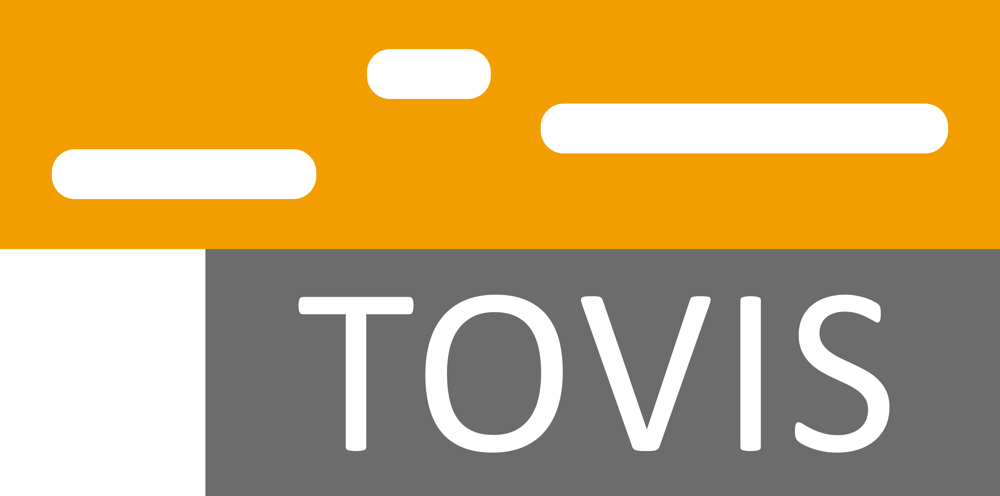

<p align="right">
  
</p>

# TOVIS: A Python toolbox for tonal visualization of musical audio and annotation data"


© [Johannes Zeitler](https://audiolabs-erlangen.de/fau/assistant/zeitler) and [Meinard Müller](https://www.audiolabs-erlangen.de/fau/professor/mueller), 2026

International Audio Laboratories, Erlangen

TOVIS is a Python toolbox for tonal visualization of musical audio
and annotation data.

The toolbox includes utilities for:

- chromagram extraction from audio, symbolic note annotations, and transcription output
- scale-likelihood analysis with configurable templates
- transposition-invariant self-similarity matrices for structure analysis
- time/measure conversion using synchronization annotations
- visualization of chromagrams, scale likelihoods, tempo curves, and structure or measure annotations

Extended documentation available [HERE](https://groupmm.github.io/tovis/).

## Installation

TOVIS requires Python 3.11 or newer. Install from PyPI:

```bash
python -m pip install tovis
```

To install from the GitHub repository:

```bash
git clone https://github.com/groupmm/tovis.git
cd tovis
python -m pip install .
```

Use `python -m pip install -e ".[docs,notebooks]"` for an editable checkout
with documentation and notebook tools. Neural transcription requires
`python -m pip install "tovis[transcription]"` and a compatible checkpoint obtained
separately. You must explicitly set `transcription_checkpoint` to the checkpoint
file path when using a neural backend; TOVIS searches no default location.
Direct `tovis.transcription` functions require the `checkpoint` keyword argument.
Standard chroma backends work without PyTorch or model weights.

## Quick start

This example generates a three-second C-major chord, extracts chroma features,
compares them with scale templates, and saves `tovis-introduction.png`.
It needs no audio files, annotations, network access, or neural checkpoints.

```python
import matplotlib.pyplot as plt
import numpy as np

import tovis
from tovis.visualization import plot_chromagram, plot_scale_likelihood

sample_rate = 22050
time = np.arange(3 * sample_rate) / sample_rate
frequencies = [261.63, 329.63, 392.00]  # C4, E4, G4
audio = sum(np.sin(2 * np.pi * f * time) for f in frequencies) / 3

chroma, feature_rate = tovis.compute_chromagram(
    audio, sample_rate=sample_rate, backend="STFT"
)
likelihood = tovis.scale_analysis_templates(chroma, template_version="binary")

fig, axes = plt.subplots(2, 1, figsize=(10, 6))
plot_chromagram(chroma, feature_rate=feature_rate, ax=axes[0])
plot_scale_likelihood(likelihood, feature_rate=feature_rate, ax=axes[1])
fig.tight_layout()
fig.savefig("tovis-introduction.png", dpi=150)
plt.close(fig)
```

To analyze your own audio, replace the synthesis and extraction steps with
`chroma, feature_rate = tovis.compute_chromagram_from_file("your-audio.wav")`.
Chroma matrices have shape `(12, n_frames)`; `feature_rate` is frames per second.
The scale likelihoods compare major-scale templates and are not a definitive
key estimate.

## Documentation

[Read the documentation](https://groupmm.github.io/tovis/) for the installation
guide, introduction, and API reference.

Build the installation guide, introduction, and API reference from the checkout:

```bash
python -m pip install -e ".[docs]"
python -m sphinx -W -b html docs/source docs/build/html
```

Open `docs/build/html/index.html` to read the documentation. Generated
documentation is excluded from version control.

## Development

The conda environment is defined in `environment.yml`. From the checkout, run
the regression checks with `python -m unittest discover -s tests`.

The demonstration notebooks and their example audio and annotation data are in
[`scripts/`](https://github.com/groupmm/tovis/tree/master/scripts). Neural
examples additionally require compatible checkpoints supplied by the user.

## License and attribution

TOVIS is available under the [MIT license](https://github.com/groupmm/tovis/blob/master/LICENSE). It includes code from
the [count-the-notes project](https://github.com/Yoni-Yaffe/count-the-notes)
by Jonathan Yaffe, Ben Maman, Meinard Müller, and Amit Bermano (2025), Onsets & Frames code by Jong Wook Kim (2019), and PyTorch STFT code by Prem Seetharaman (2017). Third-party attribution and upstream notices
are recorded in [THIRD_PARTY_NOTICES.md](https://github.com/groupmm/tovis/blob/master/THIRD_PARTY_NOTICES.md).